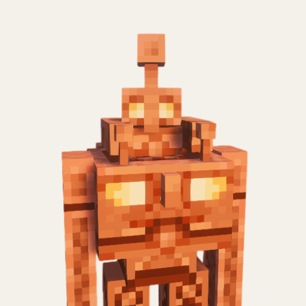
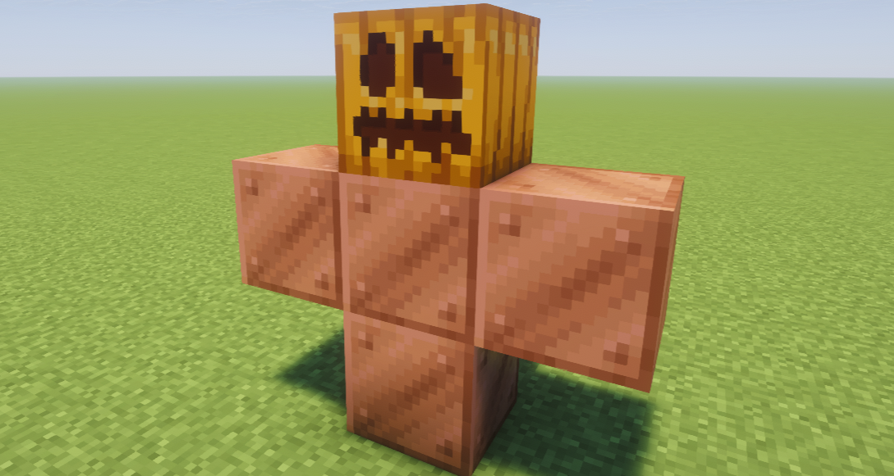
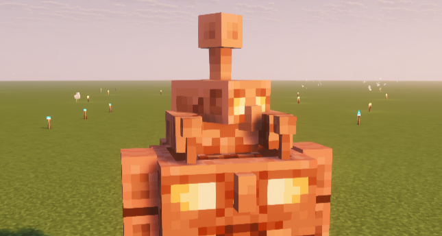
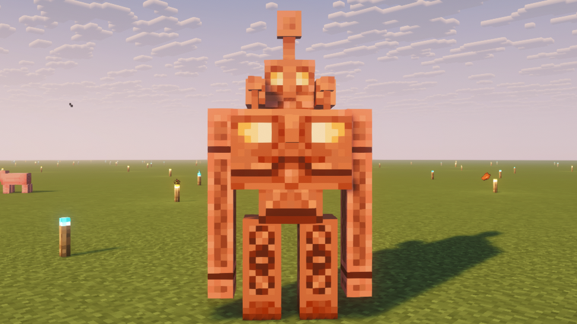

<p align="center"></p>

<h1 align="center">🤖 Mega Copper Golems</h1>

<p align="center"><b>Turn it into a guardian that's cheaper and way more orange than an Iron Golem.</b></p>

<p align="center">
  
  
  
  
  
  <a href="https://github.com/tariksharabaty/o-lib"></a>
  <a href="https://modrinth.com/organization/oidioomstudio"></a>
  <a href="https://oidioom.com"></a>
</p>

<p align="center"><a href="#-english">🇬🇧 English</a> · <a href="#-türkçe">🇹🇷 Türkçe</a></p>

---

## 🇬🇧 English

> [!IMPORTANT]
> Requires **[O Lib](https://github.com/tariksharabaty/o-lib)** and **Fabric API**.

**Mega Copper Golems** introduces a towering mechanical ally built directly from your abundance of mined copper! Standing over 2.7 blocks tall and packing serious punch, the Mega Copper Golem guards your village and base from hostile threats with metallic resonance and unyielding strength.

---

## ✨ Key Features

- 🏗️ **Multiblock Structure Summoning:** Build your golem in the world just like an Iron Golem:
  - 1 Copper Block at the base.
  - 1 Copper Block above it (torso).
  - 2 Copper Blocks on the sides (arms).
  - 1 Carved Pumpkin or Jack o'Lantern on top!
- 🛡️ **Formidable Guardian Stats:**
  - **Health:** 200 HP (Configurable 50–500 HP).
  - **Attack Damage:** 22.0 Damage (Configurable 5–50 DMG).
  - **Knockback Resistance:** 100% immune to knockback.
- 🩺 **Repairable with Copper Ingots:** Right-click your injured golem with Copper Ingots to restore 30 HP, complete with metallic anvil sounds!
- 🎁 **Custom Death Drops:** Drops 5–11 Copper Ingots, and has a rare chance (~15%) to yield a prized **Copper Chest**.
- 🔊 **Authentic Copper Sound Design:** Uses distinct Copper Bulb, Copper Grate, and Amethyst sound effects.
- ⚙️ **Integrated with O Lib & ModMenu:** Adjust golem health, damage, and summoning rules live in-game.

---

## ⚙️ In-Game Configuration

Open settings via **ModMenu** or the **O Lib** hotkey:
- `maxHealth`: Customize max golem health.
- `attackDamage`: Adjust golem hit strength.
- `enableStructureSummoning`: Toggle multiblock world creation.
- `enableCopperChestLoot`: Toggle rare copper chest drop.

---

## 📥 Installation

1. Install **Minecraft 26.3** with **Fabric Loader**.
2. Install **Fabric API**.
3. Install **O Lib** (required core library).
4. Drop `mega-copper-golems-1.1.2-mc26.3.jar` into your `mods` folder.

## 📸 Screenshots · Ekran Görüntüleri

<table>
<tr><td align="center"></td><td align="center"></td></tr>
<tr><td align="center"></td></tr>
</table>

---

## ⬇️ Download

- **Modrinth:** [Oidioom Studio](https://modrinth.com/organization/oidioomstudio)
- **GitHub Releases:** [`mega-copper-golems-1.1.2-mc26.3.jar`](../../releases/latest)

## 🔨 Building from source

Requires **JDK 25**.

```bash
# 1) O Lib is a dependency — publish it to your local Maven first
git clone https://github.com/tariksharabaty/o-lib.git
(cd o-lib && ./gradlew publishToMavenLocal)

# 2) build this mod
./gradlew build
# output: build/libs/mega-copper-golems-1.1.2-mc26.3.jar
```

## 📄 License

[MIT](LICENSE) © 2026 Oidioom / Tarek Sharabaty

---

## 🇹🇷 Türkçe

**Bakırı, Demir Golem'den daha ucuz ve çok daha turuncu bir koruyucuya dönüştürün.**

> [!IMPORTANT]
> **[O Lib](https://github.com/tariksharabaty/o-lib)** ve **Fabric API** gerektirir.

### ✨ Özellikler

- Demir Golem gibi dünyada inşa edilerek çağrılır
- Güçlü koruyucu istatistikleri
- Bakır külçeyle tamir (30 can)
- Ölünce bakır külçe ve nadiren Bakır Sandık düşürür
- Özgün bakır ses tasarımı, O Lib ile ayarlanabilir

### 📥 Kurulum

1. **Minecraft 26.3** için **Fabric Loader** kurun.
2. **Fabric API** ve **O Lib** modlarını `mods` klasörüne ekleyin.
3. `mega-copper-golems-1.1.2-mc26.3.jar` dosyasını `mods` klasörüne atın ve oyunu başlatın.

### ⬇️ İndir

- **Modrinth:** [Oidioom Studio](https://modrinth.com/organization/oidioomstudio)
- **GitHub Releases:** [`mega-copper-golems-1.1.2-mc26.3.jar`](../../releases/latest)

### 📄 Lisans

[MIT](LICENSE) © 2026 Oidioom / Tarek Sharabaty

---

<p align="center"><a href="https://oidioom.com"></a></p>
<p align="center"><b>by Oidioom — Tarek Sharabaty</b><br>
<a href="https://oidioom.com">oidioom.com</a> · <a href="https://github.com/tariksharabaty">GitHub</a> · <a href="https://modrinth.com/organization/oidioomstudio">Modrinth</a> · <a href="https://gear.oidioom.com">Gear</a> · <a href="https://www.instagram.com/oidioom">Instagram</a></p>
